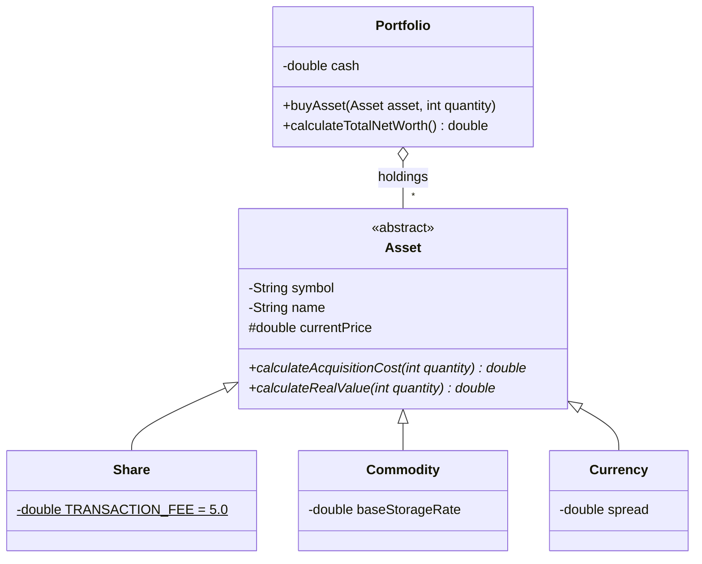

# Stock market simulator

[Polski](README.md) | **English**


An investment portfolio engine in Java. The same code buys shares, commodities and currencies, and each asset type knows by itself what a purchase costs and what it is really worth. The project demonstrates abstraction and polymorphism: `Portfolio` never checks the type of an asset.

## Model

| Class | Acquisition cost | Real value |
| --- | --- | --- |
| `Share` | price × quantity + flat 5.00 fee | price × quantity |
| `Commodity` | price × quantity | value minus a storage cost that grows with position size |
| `Currency` | price × quantity | (price − spread) × quantity, i.e. the Bid price |

`Asset` is an abstract class with two methods to override: `calculateAcquisitionCost(int)` and `calculateRealValue(int)`. `Portfolio` calls them polymorphically, without `instanceof`.



Portfolio behaviour:

- buying more than the available cash throws `IllegalArgumentException` and changes nothing,
- buying a zero or negative quantity is ignored,
- repeat purchases of the same symbol merge into one holding (assets are equal when they share a symbol).

## Running

Requires JDK 21+ and Maven.

```bash
cd gielda2
mvn test                                   # unit tests (JUnit 5)
mvn compile exec:java                      # short portfolio demo
```

Sample demo output:

```
Bought    20 x CDR  cost   2005.00 PLN, real value   2000.00 PLN
Bought    10 x XAU  cost   2500.00 PLN, real value   2475.00 PLN
Bought  1000 x EUR  cost   4300.00 PLN, real value   4250.00 PLN

Holdings:   3
Cash:         11195.00 PLN
Net worth:    19920.00 PLN
```

## Tests

25 tests in three classes check the cost formulas for each asset type, the value of the whole portfolio, rejecting purchases beyond available cash, zero quantities, merging holdings and equality by symbol.

## Structure

```
gielda2/
├── pom.xml
└── src/
    ├── main/java/com/stockmarket/
    │   ├── Main.java                  demo
    │   ├── Stock.java                 original share model
    │   ├── domain/                    Asset, Share, Commodity, Currency
    │   └── logic/Portfolio.java       portfolio
    └── test/java/com/stockmarket/     JUnit 5 tests
```
