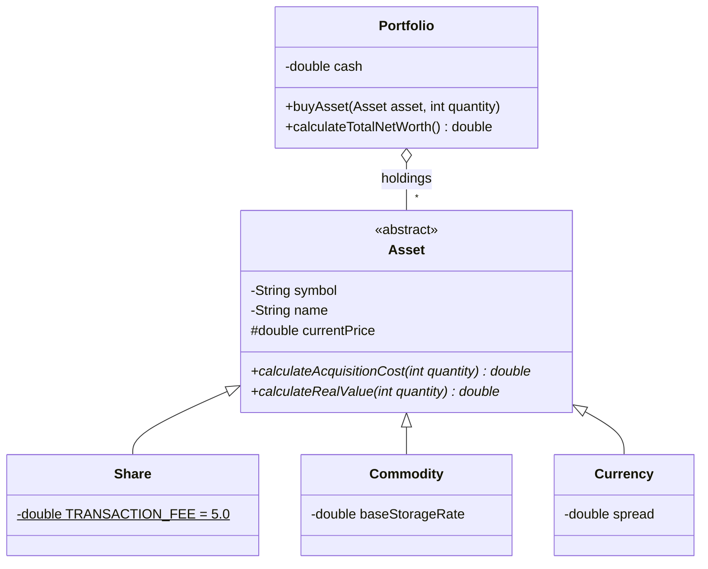

# Stock market simulator

**Polski** | [English](README.en.md)


Silnik portfela inwestycyjnego w Javie. Ten sam kod kupuje akcje, surowce i waluty, a każdy rodzaj aktywa sam wie, ile kosztuje zakup i ile naprawdę jest wart. Projekt ilustruje abstrakcję i polimorfizm: `Portfolio` nigdzie nie sprawdza typu aktywa.

## Model

| Klasa | Koszt zakupu | Realna wartość |
| --- | --- | --- |
| `Share` (akcja) | cena × ilość + stała opłata 5,00 | cena × ilość |
| `Commodity` (surowiec) | cena × ilość | wartość pomniejszona o koszt magazynowania, który rośnie wraz z wielkością pozycji |
| `Currency` (waluta) | cena × ilość | (cena − spread) × ilość, czyli cena kupna po stronie Bid |

`Asset` to klasa abstrakcyjna z dwiema metodami do nadpisania: `calculateAcquisitionCost(int)` i `calculateRealValue(int)`. `Portfolio` wywołuje je polimorficznie, bez `instanceof`.



Zachowanie portfela:

- zakup ponad stan gotówki rzuca `IllegalArgumentException` i niczego nie zmienia,
- zakup zerowej lub ujemnej ilości jest ignorowany,
- kolejne zakupy tego samego symbolu łączą się w jedną pozycję (aktywa są równe, gdy mają ten sam symbol).

## Uruchomienie

Wymagane: JDK 21+ i Maven.

```bash
cd gielda2
mvn test                                   # testy jednostkowe (JUnit 5)
mvn compile exec:java                      # krótki pokaz działania portfela
```

Przykładowy wynik pokazu:

```
Bought    20 x CDR  cost   2005.00 PLN, real value   2000.00 PLN
Bought    10 x XAU  cost   2500.00 PLN, real value   2475.00 PLN
Bought  1000 x EUR  cost   4300.00 PLN, real value   4250.00 PLN

Holdings:   3
Cash:         11195.00 PLN
Net worth:    19920.00 PLN
```

## Testy

25 testów w trzech klasach sprawdza wzory kosztów dla każdego rodzaju aktywa, wartość całego portfela, odrzucanie zakupów ponad stan, zerowe ilości, łączenie pozycji oraz równość po symbolu.

## Struktura

```
gielda2/
├── pom.xml
└── src/
    ├── main/java/com/stockmarket/
    │   ├── Main.java                  pokaz działania
    │   ├── Stock.java                 pierwotny model akcji
    │   ├── domain/                    Asset, Share, Commodity, Currency
    │   └── logic/Portfolio.java       portfel
    └── test/java/com/stockmarket/     testy JUnit 5
```
